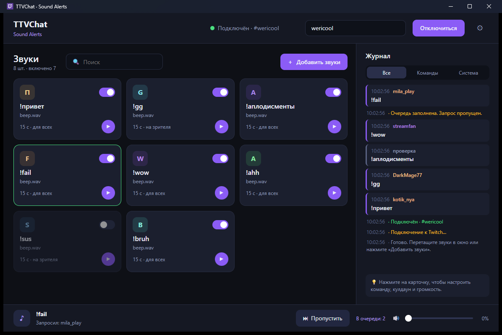
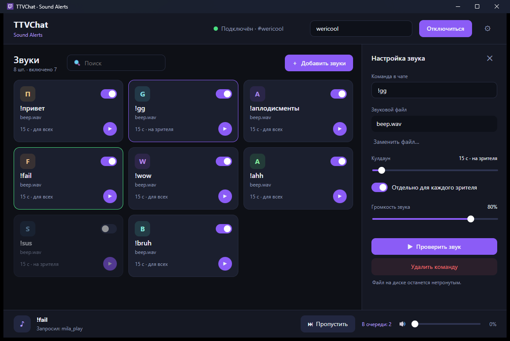

# TTVChat Sound Alerts



[**⬇ Скачать для Windows**](https://github.com/wericool/TTVChat-Sound-Alerts-v1.2/releases/latest) · exe 5 МБ, установка не нужна

Звуковые команды для чата Twitch. Зрители пишут `!команда` — на вашем компьютере играет звук. Вход в аккаунт и токены не нужны: приложение читает публичный чат.

**Tauri 2 + Rust**: готовый `exe` весит около 5 МБ (в версии на .NET было 72 МБ), ставить .NET не нужно. Требуется только WebView2, он уже есть в Windows 10/11.

## Возможности

- Карточки звуков: включение, проверка ▶, поиск.
- **Перетащите файлы или целую папку в окно** — для каждого файла команда создастся автоматически (`Мой Звук.mp3` → `!мой_звук`), настроить её можно позже.
- **Журнал**: команды зрителей выделены карточками с цветным именем, ручные проверки и системные сообщения — тихими строками; фильтр «Все / Команды / Система».
- Настройка справа: команда, кулдаун (общий или на каждого зрителя), громкость звука, замена файла.
- Очередь (до 50 запросов), пропуск, очистка, общая громкость.
- Сворачивание в трей, один экземпляр приложения.
- Импорт настроек из версии 1.2 (`Resources/config.json`) и экспорт.

Форматы: MP3, WAV, M4A, AAC, OGG, FLAC. WMA не поддерживается.

## Настройка звука



## Использование

1. Нажмите **Добавить звуки** или перетащите файлы/папку в окно.
2. Введите канал (имя или ссылка `twitch.tv/канал`) и нажмите **Подключиться**.
3. Зритель пишет команду первым словом сообщения: `!привет` или `!привет всем`.

Настройки лежат в `%LOCALAPPDATA%\TTVChat-Sound-Alerts\config.json` (запись атомарная, предыдущая версия — `config.json.bak`).

## Сборка

Нужны [Rust](https://rustup.rs) и Visual Studio Build Tools (C++).

```powershell
cd src-tauri
cargo test
cargo build --release --features custom-protocol
```

Готовый файл: `src-tauri/target/release/ttvchat-sound-alerts.exe`.

## Структура

- `ui/index.html` — интерфейс (HTML/CSS/JS без сборщика).
- `src-tauri/src/` — `config.rs` (настройки), `engine.rs` (кулдауны и дедупликация), `player.rs` (очередь и звук), `twitch.rs` (анонимный IRC по WebSocket).

